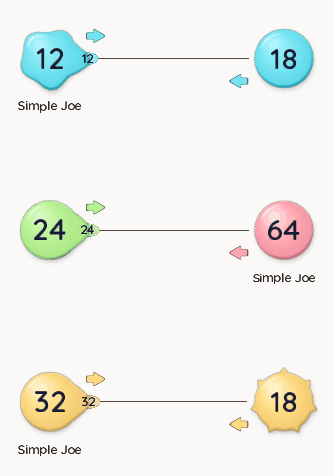

# Arrows and liquid contact, 0.6.5



Sending arrows now have a rounded head, a short stem and the node's faction color. Their darker faction border keeps the shape visible in Day. The mask lives in the existing managed UI atlas. Yellow arrows become violet in colorblind mode. Each arrow sits beside its route so it does not cover travelling counts.

Departing troops form a broad bulge, stretch a neck, then pinch free into their flatter oval. The outline closes with the neck. Friendly approach opens that connection in reverse. At actual transfer, the node count updates once and the unnumbered liquid remainder folds into its rim over 0.28 seconds. Troop numbers draw above the node material until transfer. The enemy splash keeps its existing behavior.

Fleet centers, speed, orders and combat use the existing model. The four approved battlefield textures are byte-identical to 0.6.4. Tanks keep their bodies; the digging rig keeps its intake and path. Reduced motion uses ordinary static troop bodies and omits the liquid bridge and absorption remainder.

## Native verification

`LiquidVisualTest` renders the production game at 390 × 844 and 480 × 800 in Day and Night; Night also exercises colorblind materials. It steps real units at 60 Hz, records one pose per 1/30 simulation second, and checks that friendly transfers and hostile combat happen once. It checks paused incoming contact, reduced motion and managed texture restoration. PNG export uses a bounded worker queue; export time never sets animation time.

The GIF contains 189 native poses over 6.267 simulation seconds, followed by a short end hold. It is a cropped animation recording, not a phone frame-rate measurement. Full captures and traces are under `lwjgl3/build/liquid-20261103/verified/`.

```powershell
.\opacha.ps1 :lwjgl3:liquidVisuals
# Add -PliquidFrames=true to save every pose for media export.
.\opacha.ps1 :lwjgl3:nodeControlsTest :lwjgl3:weaponsTest :lwjgl3:timingRules
```

Android emulator tests remain paused at Boris's request. This preview has no new physical-phone performance or haptic measurement.

The Stop sending walkthrough passes 47 assertions at each size. Both weapon runs pass 50 weapon-rule and 75 tactics assertions plus the pointer gesture sequence. Timing checks cover 15/30/60/90/120/144 FPS, 1×/3× speed, pause and bounded resume. The native digging check observes arrivals, smooth forward movement, zero-crew idle and restart.

## Rendering cost

The first outline implementation cost too much in the dense fixture. Small projected nodes now use eight bridge strips; larger nodes retain twenty. Fill and edge geometry are packed, and adjacent strips share calculated endpoint colors. The arrow uses two atlas quads.

Paired native desktop runs at 390 × 844, with the same 120-frame fixtures and no image export:

| Scene | 0.6.4 mean ms | 0.6.5 mean ms | 0.6.5 p95 ms | Draw calls, old → new |
| --- | ---: | ---: | ---: | ---: |
| 12 idle nodes | 0.332 | 0.359 | 0.419 | 26 → 26 |
| 12 nodes, 48 fleets | 0.949 | 0.739 | 0.990 | 63 → 62 |
| 48 nodes, 240 fleets | 4.213 | 3.422 | 4.320 | 262 → 261 |

Every sampled frame contained a fresh world. These fixed workloads measure this computer's native render cost; they do not establish physical-phone FPS. Raw comparisons are under `docs/playtests/liquid/`.

## Package

Android 0.6.5 / code 11, package `io.github.twothestar.newopacha`, signed with the existing certificate. Signature, install-ZIP identity, ZIP/native 16 KiB alignment and all 48 campaign maps are checked separately.

APK SHA-256: `2f8f32b123a759c0fc101cacc37b1bceb6285ab5c15a59e8747e2748a4f49ac5`.

ZIP SHA-256: `21c797f85e2aa6d3cb36697f8787f0dcc58c1c7968aa25e026f58b8d9e9d5b0b`.

## Reuse

Autoskill outcome: extend the project note and native harness. Keep count labels above deforming parents; snapshot a contact's population and owner rather than retaining a pooled Unit; share the existing managed primitive atlas for small icons; and separate animation sampling from export I/O. These checks fit the existing game-feel and input-testing workflow; no skill was installed or published.
