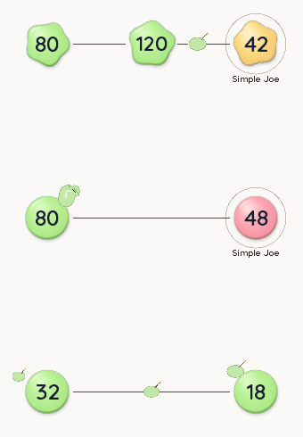

# Organic battlefield, 0.6.3

Boris's 30 October brief changes three in-world graphics while retaining the
approved candy material and overhead map.



- Factories ripple and breathe through their contour. Their centered numbers
  remain upright and still. The Conveyor marks are removed.
- Bombs are matte troop bubbles with a curved fuse and tiny warm sparks.
  A converted bomb has no invented troop population. The model supplies its
  visible position and tap target; enemy secrecy is retained.
- Cannons grow from the node rim as soft, curved tubes. The mouth opens to
  release a little black ball and settles afterward. Armed tubes and mouths
  remain 1.5 times thicker. Their roots stay clear of the central number.

The original four battlefield PNGs are byte-identical to 0.6.2. Deformation
uses shared mesh corners and the existing geometry atlas. Pausing holds the
animation clock. Reduced motion keeps a fixed wavy factory and fuse ember,
with brief target feedback and no flying projectile.

## Verification

`OrganicVisualTest` runs the real native renderer and actual conversion and
firing actions. Four runs cover 390×844 and 480×800 in Day/Night, with 28
stills covering firing, impact, pause, reduced motion and colorblind mode.
Rendered factory pixels stay identical under pause and when simulation time
advances with reduced motion enabled. Numeric shot cost and actual damage
are checked independently of the animation.

The final weapon gesture checks pass at both sizes. Timing checks pass at
15/30/60/90/120/144 display FPS, at 1×/3×, including pause/resume and every
map size. The coordinated gameplay work separately passed the 48-map,
3,871-assertion campaign checks and the full phone campaign tour.

The native frame export uses a worker for PNG encoding. Its preview follows
recorded simulation timestamps; capture readback is excluded from performance
measurement. The export is a demonstration of the motion, not measured phone
FPS. Repeat it with:

```powershell
.\opacha.ps1 -GradleArguments @(':lwjgl3:installDist', ':lwjgl3:smokeTestClasses')
.\scripts\capture-organic.ps1 -OutputRoot 'lwjgl3/build/organic-fresh'
```

## Rendering cost

The same compiled benchmark and fixed 390×844 fixtures ran against the
retained published 0.6.2 binaries and the new binaries, with the emulator
stopped. Costs are desktop CPU/GL submission time, not physical-phone GPU
time. All runs drew a fresh world on all 120 measured frames.

| Scene | 0.6.2 mean ms | 0.6.3 mean ms | Old drawing calls | New drawing calls |
| --- | ---: | ---: | ---: | ---: |
| 12 idle nodes | 0.344 | 0.395 | 43.8 | 26 |
| 12 nodes, 48 fleets | 0.807 | 1.022 | 80 | 63 |
| 48 nodes, 240 fleets | 4.577 | 4.033 | 316 | 262 |

The crowded scene's p95 cost is 4.901 ms. Small scenes spend a little more
CPU time evaluating the organic contour; drawing and vertex counts fall.
The batching and fresh-frame budgets pass. [Raw results](playtests/organic/)
retain the binary and benchmark fingerprints.

## Android package and limits

Version 0.6.3/code 9 uses the existing application ID and signing certificate.
APK signature, ZIP identity, ARM64/x86-64 ELF alignment, ZIP 16 KiB alignment
and lint pass; lint reports zero errors and six warnings.

The exact installed APK was inspected on the Android 15 Pixel 8a software
emulator at 576×1280. The saved test map shows factories, edge/waiting bombs
and cannons together. Running, arming and firing captures are retained, and
the paused battlefield is identical after background/resume.

Boris then requested that emulator tests stop to free memory for the café
viewer. The emulator is stopped. Android Night/colorblind follow-up is
paused; both modes already pass the native desktop renderer at phone sizes.
Test-device preference backups are retained for restoration when emulator
testing resumes. Physical-phone FPS, touch feel, heat and battery are
unmeasured. The completed gameplay work's rules are documented in
[tactics.md](tactics.md); this visual pass does not tune them.

## Reusable procedure

Autoskill outcome: project note and capture script. Check all active chats
using the checkout before editing shared renderers, rather than relying on
the historical owner. Preserve their drawn-position/tap-position contract.
Keep JARs unchanged while native tests use them. Use rendered pixels to check
pause and reduced motion, move PNG encoding off the render thread, and retain
the frame timestamps. A capture export is not a performance benchmark.
No skill was installed or published.
